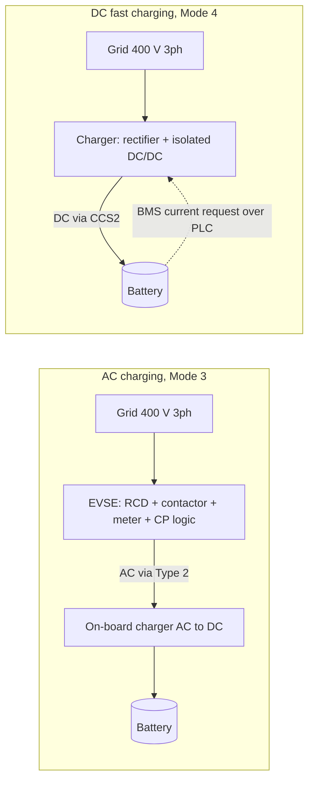
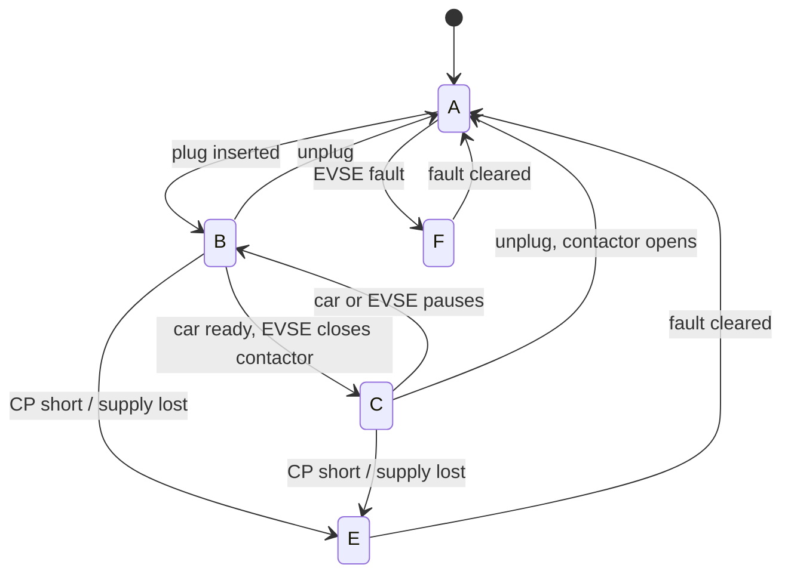

# 00 — How EV charging works (T0.3)

Status: v0.2. Numbers below are cross-checked against at least two public sources that cite IEC 61851-1. Clause and table numbers still need confirming against a local copy of IEC 61851-1:2017 (marked **CHECK CLAUSE**). Every number used later in a calc goes into `assumptions.csv` with its source.

## 1. The one idea that matters

An EV battery only stores DC. Every charging method comes down to **where the AC-to-DC conversion happens**, and that decides who has to size the rectifier.

| | AC charging | DC fast charging |
|---|---|---|
| Converter | Inside the car: on-board charger (OBC) | Inside the charger cabinet (off-board) |
| What the station is | An EVSE: contactor, protection, metering and pilot logic. It passes grid AC through | A power converter: rectifier + isolated DC/DC stage |
| Who limits power | The lower of the EVSE offer, the cable rating and the car's OBC (often 7.4 to 11 kW; some cars 22 kW) | The charger rating and the current the car's BMS requests |
| IEC 61851-1 mode | Mode 3 | Mode 4 |
| Connector | Type 2 (IEC 62196-2) | CCS2 / Combo 2 (IEC 62196-3) |
| This hub | 2 × 22 kW (A04) | 2 × 60 kW (A05) |

**Design consequences for this hub**

- A 22 kW AC point delivers 22 kW only to a car whose OBC accepts it. The unmanaged 180 kW peak in P2 is therefore a worst case, and the session model (T2.3) should draw an OBC limit per car.
- The DC charger's rectifier sits on our side of the meter, so its efficiency, power factor and harmonics land on our supply (T1.3, T2.1, T2.6).
- On an AC point, the car's on-board charger is a rectifier. If it develops an insulation fault, the earth leakage can be smooth DC. Smooth DC saturates the core of a normal Type A RCD and stops it tripping, even on a real AC fault. So an AC circuit needs either an RCD Type B, or a Type A RCD plus a device that disconnects at 6 mA DC leakage (IEC 60364-7-722, **CHECK CLAUSE**; decided in T3.5).

## 2. Charging modes (IEC 61851-1)

A mode describes how much protection and communication sits between the grid and the car. It says nothing about speed.

- **Mode 1:** ordinary socket, plain cable, no communication. Not for public use.
- **Mode 2:** ordinary socket, with a protection and control box built into the cable (portable home charger).
- **Mode 3:** dedicated AC EVSE with a permanent control pilot link. The EVSE energises the cable only after the car says it is connected and ready. **Our AC points.**
- **Mode 4:** off-board DC charger with digital communication to the car. **Our DC points.**

## 3. Connectors

- **Type 2 (IEC 62196-2):** 7 contacts: L1, L2, L3, N, PE, and two signal pins, CP (control pilot) and PP (proximity pilot). Single- or three-phase.
- **CCS2 (IEC 62196-3):** the Type 2 face with two large DC+ / DC− pins added below. During DC charging only PE, CP and PP of the upper part are used; the car and charger talk by power-line communication over the CP wire (DIN SPEC 70121 or ISO 15118-2; which one the chosen charger supports is checked in T1.3).
- **Why CCS2:** Egypt required CCS2 on public fast chargers from April 2025 (see project plan sources).

### Other connectors and why they're excluded

| Connector | Type | Mainly used in |
|---|---|---|
| Type 1 (SAE J1772) | AC | North America, Japan |
| Type 2 (IEC 62196-2) | AC | Europe, Egypt, most of the world |
| CCS1 | AC + DC | North America |
| CCS2 | AC + DC | Europe, Egypt |
| CHAdeMO | DC | Japan, older Japanese cars |
| GB/T | AC and DC (separate standards) | China |
| NACS (SAE J3400, Tesla) | AC + DC | North America, now spreading |

This hub has four connectors of two types: 2 × Type 2 (AC) and 2 × CCS2 (DC). The rest are excluded:

- **CCS2 only for DC:** Egypt's rule for public fast chargers (April 2025) leaves no choice. CHAdeMO and GB/T cars need an adapter or cannot use the DC points.
- **Type 2 only for AC:** it matches CCS2 on the vehicle side and is the standard in IEC 62196-2, the basis of the design (A03). Use of Type 2 on Egyptian public AC points is **TO VERIFY** against EgyptERA rules.
- **CCS1 and Type 1:** North American and Japanese variants, not used in the Egyptian market (**TO VERIFY** with the T1.4 parc data).
- **NACS:** a North American standard, so out of scope for a Cairo site. A future v2 could add a NACS adapter note to `ROADMAP.md`.

## 4. Control pilot (CP) and proximity pilot (PP)

The CP wire is a conversation where the charger sends a voltage and the car answers by loading it down. The car never sends data on this wire; it only changes a resistor. Defined in IEC 61851-1 Annex A.

1. **The charger sends a square wave.** The EVSE puts a 1 kHz signal swinging between +12 V and −12 V on CP, through a 1 kΩ resistor. That resistor lets the car pull the voltage down.
2. **No car: the signal stays at +12 V.** Nothing loads the wire, so the high level is +12 V (state A).
3. **The car loads the wire.** On plug-in, the car connects a diode and a resistor from CP to PE. This forms a voltage divider with the charger's 1 kΩ, so the high level drops (about +9 V, state B). When the car is ready, it switches in a second resistor in parallel, the total gets smaller and the level drops further (about +6 V, state C). Exact resistor values and tolerances are in Annex A (**CHECK CLAUSE**).
4. **The charger reads the high level to know the state.** 12 V means no car, 9 V means connected, 6 V means ready. At 6 V the EVSE closes the contactor.
5. **The diode is a safety check.** It passes only the positive half of the wave to the car's resistors, so the negative half stays at −12 V. If the EVSE does not see −12 V, the diode is missing or shorted and it must not energise the cable (**CHECK CLAUSE**).

| State | Meaning | CP positive level (nominal) | OCPP 1.6 status it usually maps to* |
|---|---|---|---|
| A | No vehicle connected | +12 V | Available |
| B | Vehicle connected, not ready | +9 V | Preparing (SuspendedEV mid-session) |
| C | Vehicle ready, charging, no ventilation needed | +6 V | Charging |
| D | Vehicle ready, ventilation required | +3 V | Charging (rare; many EVSEs refuse it) |
| E | Error: CP shorted to PE, or EVSE has no supply | 0 V | Faulted |
| F | EVSE not available | −12 V | Unavailable or Faulted |

\* My working interpretation for T4.4, not text from the OCPP spec. Validate against the OCPP 1.6 connector status table before building the simulator. Voltage tolerances are in Annex A (**CHECK CLAUSE**).

**PWM duty cycle → maximum current the car may draw** (IEC 61851-1 Annex A; same rule in SAE J1772):

| Duty cycle D | Meaning |
|---|---|
| 3 % to 7 % | Digital communication; **5 %** is used when CP carries PLC (this is what a CCS2 DC session shows) |
| 8 % to < 10 % | 6 A |
| 10 % to 85 % | I = D × 0.6 A (up to 51 A) |
| 85 % to 96 % | I = (D − 64) × 2.5 A (up to 80 A) |

Worked example: our 32 A AC point needs D = 32 / 0.6 = 53.3 %. Reading it the other way, 53 % tells the car it may draw 31.8 A, so it stays at or below 32 A per phase.

**Proximity pilot:** a resistor between PP and PE inside the Type 2 plug tells the EVSE the cable's rating (IEC 61851-1 Annex B):

| PP–PE resistor | Cable rating | Typical conductor |
|---|---|---|
| 1.5 kΩ | 13 A | 1.5 mm² |
| 680 Ω | 20 A | 2.5 mm² |
| 220 Ω | 32 A | 6 mm² |
| 100 Ω | 63 A three-phase (70 A single-phase) | 16 mm² |

One test-equipment guide lists 200 Ω for 32 A; the IEC-citing tester datasheets list 220 Ω. Use 220 Ω and confirm in Annex B.

**Rule to remember:** current actually drawn = min(EVSE PWM offer, cable PP rating, car OBC limit).

## 5. One AC session, start to finish (links to OCPP in P4)

1. Plug in: CP goes A → B. Charger sends `StatusNotification` (Preparing).
2. Driver taps RFID: `Authorize`, then `StartTransaction`.
3. EVSE starts PWM at its offer (e.g. 53 %); car signals ready, CP B → C, contactor closes, `StatusNotification` (Charging), `MeterValues` start.
4. Backend lowers the limit with `SetChargingProfile` (T4.6): EVSE lowers the duty cycle, car follows within seconds.
5. Car full or driver stops: CP C → B, contactor opens, `StopTransaction`. Unplug: B → A, Available.

A DC session follows the same OCPP messages, but the current is negotiated by digital messages (5 % duty) and the charger also runs an insulation check and precharge before closing its contactors (IEC 61851-23).

## Sources

- IEC 61851-1:2017, *Electric vehicle conductive charging system — Part 1: General requirements*. Annex A (control pilot, PWM), Annex B (proximity, cable coding). Local copy, not committed.
- IEC 62196-2 and IEC 62196-3, connector dimensions and contact assignments.
- IEC 61851-23, DC EV charging station requirements.
- Public cross-checks used for the numbers above:
  - IET Engineering Communities, "EV load control" thread, reproducing the IEC 61851-1 duty-cycle table: https://engx.theiet.org/f/wiring-and-regulations/22912/ev-load-control
  - eInfochips, "IEC 61851: Everything You Need to Know": https://www.einfochips.com/blog/iec-61851-everything-you-need-to-know-about-the-ev-charging-standard/
  - Gossen Metrawatt PRO-Typ II test adapter datasheet (PP codings per IEC 61851-1): https://asset.conrad.com/media10/add/160267/c1/-/en/001625600DS01/podatkovna-tablica-1625600-gossen-metrawatt-z525a-pro-typ-ii-mjerni-adapter-1-st.pdf
  - e-mobileo, PP resistor values and conductor sizes: https://www.e-mobileo.de/was-macht-der-der-proximity-plug-pp-genau/
