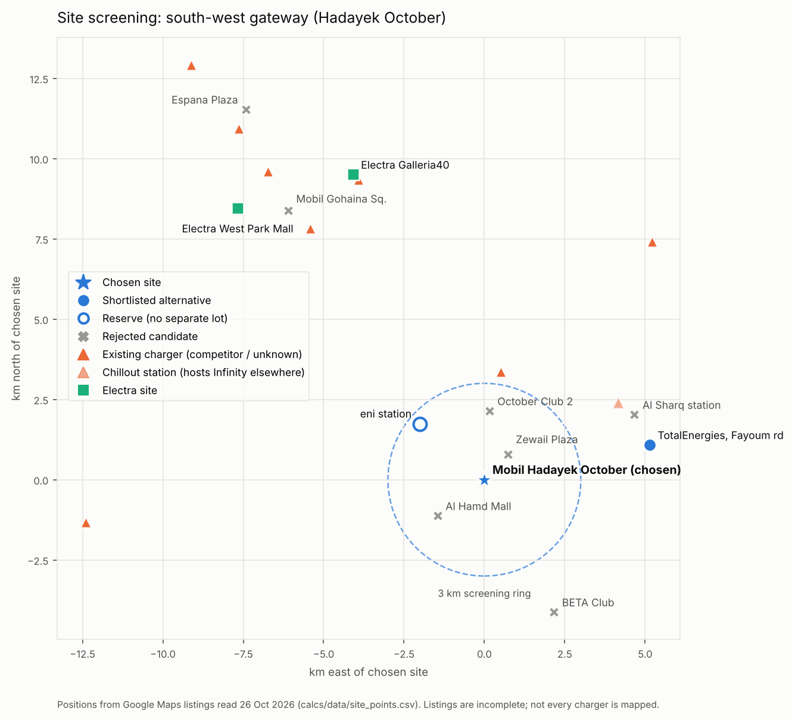
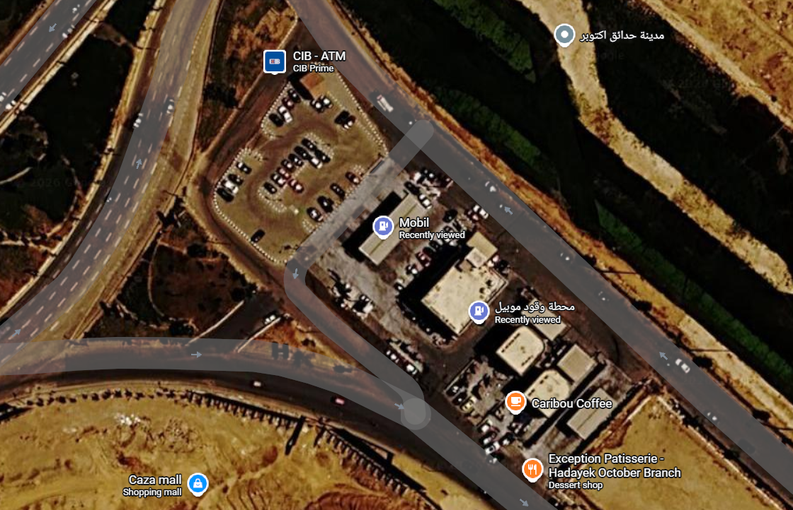
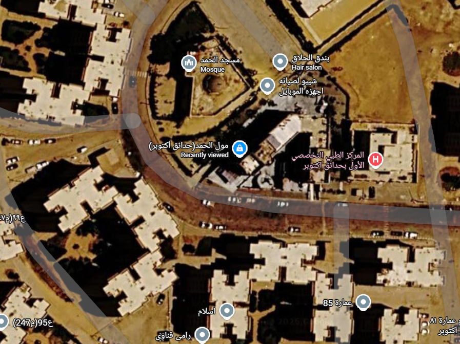
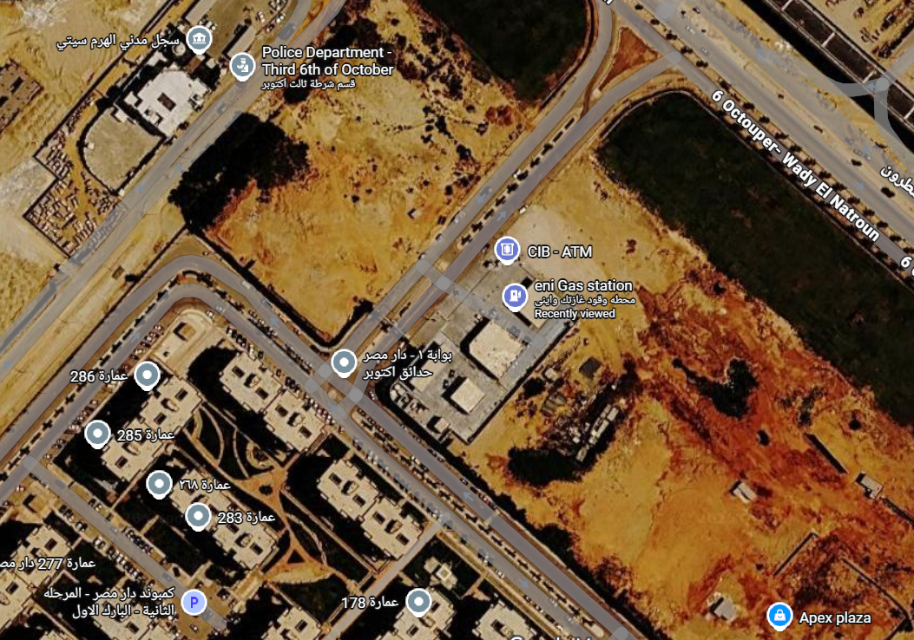
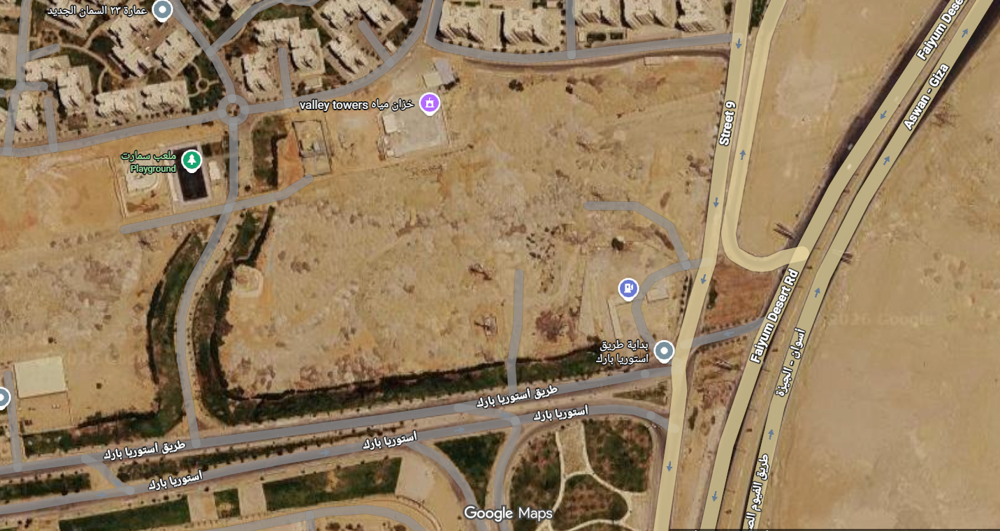

# 02 — Site assessment (T1.2)

**Status:** Lite. Desk study from public maps and listings, read 26 Oct 2026. Nobody has visited the site, and the host has not been contacted.
**Independence:** This is a self-initiated design study. It has no affiliation with Mobil, the station operator, or Electra (Raya Smart Buildings).

---

## 1. What this document does

Electra's public map page invites owners of commercial spaces to suggest a charger location. The form asks for the address, the number of parking spaces and further details about the site. This document runs the screening a technical engineer would apply to such a request, from the operator's side:

1. Choose a **search area** that extends Electra's network.
2. List **host candidates** in that area and screen them against four rules.
3. Pick **one site** as the design basis for this package and record what is still unverified.

The four screening rules:

| # | Rule | Why it matters |
|---|---|---|
| R1 | The host controls **off-street parking** (not public kerbside) | The host must be able to dedicate bays to charging. |
| R2 | **No existing charger within about 3 km** | The site should add coverage, not compete for the same drivers. |
| R3 | **No Electra site within about 3 km** | A new hub next to Electra's own site mostly takes sessions from it. |
| R4 | Room for **4 bays + DC cabinets + a board**, and possibly a supply kiosk | Physical footprint, before any electrical design. |

Grid capacity is the fifth question. It cannot be checked remotely (section 7).

## 2. Step 1: choosing the search area

| Area | Fit with Electra's stated plan | Competition (Oct 2026 listings) | Verdict |
|---|---|---|---|
| East Cairo (New Cairo, Obour, Shorouk, Madinaty, Rehab) | In the plan; Electra has 1 site there | Infinity, Revolta, Ikarus, SHA7EN and Mega Plug all present | Dropped |
| **South-west gateway (Hadayek October, Hadayek El Ahram)** | Extends Electra's West Cairo cluster and leads onto the Upper Egypt road | Very few listed chargers in the district core | **Selected** |
| Cairo–Alexandria Desert Road | Fits the highway plan | Infinity building twin chargers along the corridor | Dropped |
| Cairo–Ain Sokhna Road | Fits the highway plan; Electra's Sokhna site was offline | Not checked | Possible later study |
| Upper Egypt corridor towns | Fits "infrastructure is thin" | Probably low | Outside Greater Cairo (A01); Electra's six Cairo–Aswan stations are already planned at unknown sites |

Electra's public map listed 10 sites on 24 Oct 2026, 5 of them in West Cairo (Sheikh Zayed ×2, 6th of October ×2, New Giza). Hadayek October is the large residential district directly south of that cluster, between the Wahat and Fayoum roads.

## 3. Step 2: candidates screened

Distances are great-circle distances computed by `calcs/site_screen.py` from the coordinates in `calcs/data/site_points.csv`. The full table is written to `docs/tables/site_screen.csv`.



*Figure 1. Candidates, existing chargers and Electra sites around the chosen site. Generated by `calcs/site_map.py`.*

| ID | Candidate | Host type | Nearest listed charger | Nearest Electra site | Result | Reason |
|---|---|---|---|---|---|---|
| S1 | **Mobil, Hadayek October** (W2JV+99) | Fuel station + shops | 3.4 km | 10.4 km | **Chosen** | Passes R1–R4 on satellite view (section 4) |
| S2 | eni, 6th of October–Wadi El Natrun road | Fuel station + café | 3.0 km | 8.1 km | Reserve | Compact corner plot with no separate lot (Figure 4); viable only if the vacant land next to it becomes available |
| S3 | TotalEnergies, Cairo–Fayoum road | Fuel station | 5.2 km | 12.5 km | Shortlisted (#2) | Best corridor position on open land (Figure 5), but the station is barely visible on the imagery; TotalEnergies may run its own charging |
| S4 | Al Hamd Mall, Hadayek October | Neighbourhood mall | 4.9 km | 11.0 km | Rejected (R1) | No off-street lot; cars park on the public ring road |
| S5 | Zewail Plaza Mall | Mall | 2.6 km | 10.0 km | Rejected (R1, R2) | Reviewers report no parking; charger 2.6 km away |
| S6 | October Club 2 | Members' club | 1.3 km | 8.5 km | Rejected (R2) | Members only; charger 1.3 km away |
| S7 | BETA Sporting Club | Compound club | 7.7 km | 15.1 km | Rejected | Members only; small |
| S8 | Al Sharq station, Wahat road | Fuel station | 4.4 km | 11.5 km | Rejected (R2) | 0.6 km from a Chillout station; Chillout hosts Infinity chargers elsewhere |
| S9 | Mobil 6th of October, Gohaina Square | Flagship fuel station | 0.9 km | 1.6 km | Rejected (R2, R3) | Sha7en charger 0.9 km away; Electra West Park Mall 1.6 km away |
| S10 | Espana Plaza Mall, Sheikh Zayed | Open-air mall | 0.6 km | 3.1 km | Rejected (R2) | Infinity-e charger 0.6 km away |

S9 and S10 are strong hosts in themselves. They fail because they sit inside the area Electra and its competitors already cover, which is the reason for choosing the area first.

**Limitation:** competitor positions come from Google Maps listings, which are incomplete. Before any commitment, check the Infinity EV, Elsewedy Plug and Electra apps and PlugShare around S1.

## 4. Chosen site: Mobil, Hadayek October

| Item | Value |
|---|---|
| Location | Junction of Ahmed Zewail Road and the 6th of October–Wadi El Natrun road, Hadayek October, Giza |
| Coordinates | 29.9309 N, 31.0435 E |
| Plus code | W2JV+99 Hadayek October |
| Host type | Fuel station with shop, food outlets, CIB ATM and car wash |
| Nearest listed charger | 3.4 km (unnamed listing, 6th of October) |
| Nearest Electra site | 10.4 km (Galleria40) |
| Distance to Cairo–Fayoum road candidate (S3) | 5.2 km |



*Figure 2. Satellite view of S1 (Google Maps, satellite layer, captured 26 Oct 2026). Imagery © Google; Airbus, CNES / Airbus, Maxar Technologies.*

**What the satellite view shows**
- A fuel forecourt with a canopy in the middle of the plot, and a service block to the south-east with Caribou Coffee and Exception Patisserie.
- A **separate, kerbed parking lot on the north-west side**, with a central island and about 20 parked cars, reached from the station's internal road. Its size, roughly 40–50 m across, is an estimate from the map scale bar. A CIB Prime ATM sits at its north corner.
- Road access from three sides; the high-speed rail alignment and a green strip run along the north-east edge. Caza Mall is across the road to the south.

**Why it fits Electra**
- Electra already uses a Mobil station as a host (its AUC site), so the host relationship type exists.
- A fuel stop with food gives the 20–40 minute dwell time that suits DC charging. The AC points serve longer stays and staff.
- It extends Electra's West Cairo cluster south, about 5 km from the Fayoum road exit toward Upper Egypt.

**Footprint check (R4)**

| Element | Allowance |
|---|---|
| 4 bays at about 2.8 m wide × 5.5 m deep | about 11.2 m × 5.5 m |
| Equipment strip at the head of the bays (DC cabinets, AC posts, bollards) | 1 m deep along the bays |
| Hub distribution board with 1 m clear working space | about 2 m × 2 m |
| Optional MV/LV kiosk with clearance (only if DEC-03 needs one) | about 5 m × 5 m |
| **Total without kiosk** | **about 12 m × 7 m plus the board** |

That fits inside the lot on the imagery. Whether the host will give up 4 bays is a question for the host (section 8).

## 5. Assumed layout for the design

The package needs cable lengths for T3.2 (sizing), T3.3 (voltage drop) and T5.1 (BoQ). Until the draw.io sketch is drawn over the satellite screenshot and measured, these are **assumed values**. Each gets an ID in `assumptions.csv` so `calcs/cables.py` reads them from the register.

| ID | Assumption | Value | Status |
|---|---|---|---|
| A21 | Charging bays in the north-west lot, in one row of 4 | layout | ASSUMED – confirm on sketch |
| A22 | Supply point (station LV board or new kiosk) to hub MDB | 40 m | ASSUMED – measure on sketch |
| A23 | Hub MDB to DC1 | 15 m | ASSUMED – measure on sketch |
| A24 | Hub MDB to DC2 | 18 m | ASSUMED – measure on sketch |
| A25 | Hub MDB to AC1 / AC2 | 22 m / 25 m | ASSUMED – measure on sketch |
| A26 | Installation method: buried in duct across the lot | method | ASSUMED – drives ground derating (A07, 30 °C ground) |

Replace each value with the measured length once the sketch exists, and note the change in the decision log.

## 6. Site conditions

- **Accessibility:** at least one bay widened to about 3.6 m with a level transfer zone, and the charger outlet within reach from a seated position.
- **Ventilation:** outdoor, open-air installation. DC cabinets need their datasheet clearances for cooling airflow.
- **Flooding and water:** flat desert plot; rain is rare but intense. Mount chargers on raised plinths and check where the lot drains. This supports the IP rating checked in T1.3.
- **Physical protection:** bollards and wheel stops in front of every charger. Fuel-station traffic manoeuvres close to the lot, which supports the IK rating checked in T1.3.
- **Hazardous area:** keep chargers and the board outside the fuel dispensing and tank vent hazardous zones. The zone extents come from the station's own hazardous-area drawing, which is not public. Placing the bays in the north-west lot, away from the forecourt, is the working assumption.

## 7. Grid supply (open)

Spare capacity at this site is unknown. Only the distribution company serving Hadayek October can confirm it. The unmanaged hub draws about 180 kW / 183 kVA (T2.1), so the design covers both outcomes:

- **Option A — existing LV supply with limited spare capacity:** load management caps the hub at the value the utility allows. The T2.4 study shows how much energy is delayed at each cap.
- **Option B — dedicated MV/LV kiosk (e.g. 250 kVA):** full output, with room for a third charger later.

DEC-03 records the comparison. Questions for the distribution company:
1. MV voltage at the site (11 or 22 kV) and the nearest MV/LV substation.
2. Loading of that substation and spare capacity at LV.
3. Prospective fault level at the connection point (needed for T3.4).
4. Earthing arrangement of the supply.
5. Connection cost and lead time for options A and B.

## 8. Open items (TO VERIFY)

| # | Item | How to close it |
|---|---|---|
| V1 | Who controls the north-west lot: the station, the food outlets, the CIB Prime branch or the plot landlord | Site visit / ask the station manager |
| V2 | Whether fuel-queue traffic blocks access to the bays | Site visit at a busy hour |
| V3 | Spare grid capacity, contracted kVA and maximum demand | Distribution company; station bills |
| V4 | Hazardous-area zone extents around dispensers and vents | Station's hazardous-area drawing |
| V5 | Complete competitor check | Infinity, Plug and Electra apps; PlugShare |
| V6 | Cable lengths A22–A25 | Measure on the draw.io sketch |
| V7 | Who owns the vacant land next to S2, and the S3 forecourt layout | Site visit |

## 9. Satellite views of the other candidates

All screenshots were taken from the Google Maps satellite layer on 26 Oct 2026. Imagery © Google; Airbus, CNES / Airbus, Maxar Technologies. Use Figure 2 as the background layer of the draw.io site sketch, and measure the cable routes on it (section 5).



*Figure 3. S4, Al Hamd Mall (rejected, R1). A small commercial block between a mosque and a medical centre, surrounded by apartment buildings. There is no off-street lot: cars park along the public ring road, which the mall does not control, and there is no space for DC cabinets or a kiosk.*



*Figure 4. S2, eni station (reserve). A compact corner plot with a forecourt, a shop building and a CIB ATM, next to Dar Misr gate 1. There is no separate parking lot; the large vacant land to the east is not part of the station, and its owner is unknown.*



*Figure 5. S3, TotalEnergies on the Cairo–Fayoum road (shortlisted #2). The station is a small structure on a loop road off Street 9, beside the Fayoum Desert Road where the Aswan–Giza carriageway splits off. The surrounding land is open, which helps the footprint, but the forecourt layout is barely visible and the land ownership is unknown.*

## 10. Effect on other decisions

- **DEC-01 / DEC-02:** Electra's DC range is 30, 120 and 180 kW (Sungrow); it has no 60 kW unit. Add a 120 kW option to the DEC-01 comparison.
- **DEC-03:** supply options A and B in section 7.
- **A01** (location): update from "commercial site in Greater Cairo" to "S1, Mobil Hadayek October, assumed layout".

## 11. Reproduce

```bash
python calcs/site_screen.py   # distances -> docs/tables/site_screen.csv
python calcs/site_map.py      # Figure 1 -> docs/img/02-site-overview.png
```

## Sources

- Electra EV charging map and "Suggest a charger location" form: https://electrachargers.com/map (read 24 and 26 Oct 2026)
- Electra company profile compiled 24 Oct 2026 from electrachargers.com, Raya Holding releases and Egyptian business press (project file)
- Google Maps listings and satellite imagery for every coordinate in `calcs/data/site_points.csv` (read 26 Oct 2026). Imagery © Google; Airbus, CNES / Airbus, Maxar Technologies.
