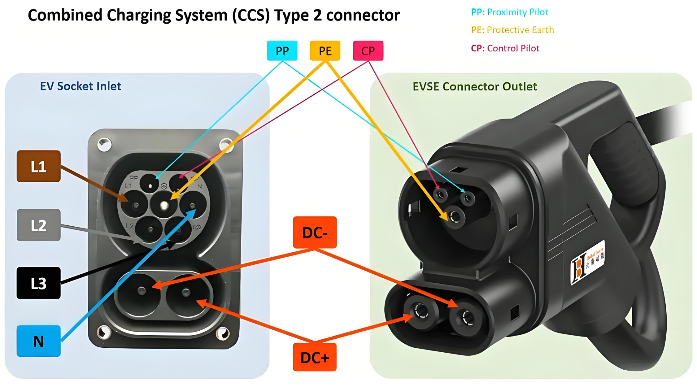

# How a CCS2 connector works

Oct 26, 2026 · Abdelrahman Hany

## Overview

A CCS2 car has one inlet that accepts two different plugs: a Type 2 plug for AC charging and a CCS2 plug for DC charging. The reference picture shows both halves of a DC connection: the inlet on the car and the DC plug on the charger's cable. Everything below explains what each pin does and why the DC plug needs only five of them.

## The car inlet

The inlet is a complete seven-pin Type 2 socket on top, with two large DC pins added underneath. The DC pins are the "Combo" part that turns Type 2 into CCS2.

| Pin | Position in inlet | What it does | Used for AC | Used for DC |
| --- | --- | --- | --- | --- |
| L1, L2, L3 | Left, bottom-left, bottom-right of the top half | The three phases. The 22 kW Sungrow AC22E-01 delivers 32 A on each. | Yes | No |
| N | Right of the top half | Neutral | Yes | No |
| PE | Large centre pin | Protective earth. It is the longest pin, so it connects first and disconnects last, and the car body is earthed before any power pin touches. | Yes | Yes |
| CP | Small top-right pin | Control pilot: the charger and the car talk over this pin | Yes | Yes |
| PP | Small top-left pin | Proximity pilot: tells the car a plug is inserted, so it blocks driving away. On AC cables, a resistor between PP and PE also codes the cable's current rating. | Yes | Yes |
| DC+, DC− | Two large pins in the bottom half | DC power, up to 1000 V. The Sungrow IDC80E delivers 200 A at 60 kW. | No | Yes |

## The charger plug

The DC plug has no L1, L2, L3 or N pins. It keeps only the three signal pins (PP, CP and PE) and adds the two DC power pins, so it looks like a Type 2 plug with the top half hollowed out. The car's AC pins sit unused during DC charging.

In the reference picture, the DC+ and DC− arrows cross over because the plug faces the inlet: the plug's right pin meets the inlet's left pin.

## Why CP alone carries DC communication

No extra communication pins are needed: CP and PE carry the whole conversation between car and charger.

On AC, the charger tells the car its maximum current through the PWM duty cycle on CP (the control pilot topic from T0.3). On DC, the charger sets CP to a 5 % duty cycle, which means "digital communication required". The car and charger then exchange high-frequency data signals carried on top of the CP wire (power-line communication, PLC), using DIN SPEC 70121 or ISO 15118. The IDC80E datasheet lists both.

Through that link the car requests voltage and current, and the charger:

1. checks insulation before closing its DC contactors,
2. follows the car's requests during charging,
3. ramps the current to zero before the contactors open.

## How this ties to the EV hub design

There are two independent links: car to charger (ISO 15118 / DIN SPEC 70121 over CP) and charger to backend (OCPP). The P4 simulator models only the charger-to-backend link.

- **One inlet, two plugs.** This is the physical reason CCS2 for DC forces Type 2 for AC, as recorded in DEC-02.
- **Interview answers.** "How does the car know how much power it gets?" → ISO 15118 / DIN 70121 over CP. "How does the site stay under its cap?" → OCPP SetChargingProfile from the backend to the charger.
- **Earthing.** The PE pin is where the TN-S earthing from T3.6 reaches the car body, which is why disconnection times matter at the charger.
- **Figure for docs/00-background.md.** Redraw the inlet and plug yourself rather than reusing the manufacturer's photo.

## Sources

- [Sungrow IDC80E datasheet V2](https://info-support.sungrowpower.com/datasheet-material/cd0d7912-cdfd-420e-abb1-a0a4d010a12a.pdf) (CCS2 + CCS2, 200 A at 60 kW, DIN SPEC 70121 and ISO 15118)
- [Sungrow AC22E-01 datasheet V6](https://info-support.sungrowpower.com/application/pdf/2025/08/04/DS_20250722_AC22E-01_Datasheet_V6_EN.pdf) (Type 2, 32 A, OCPP 1.6J)
